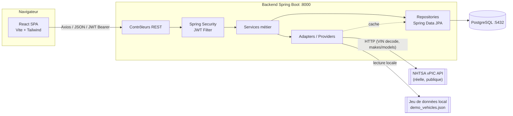
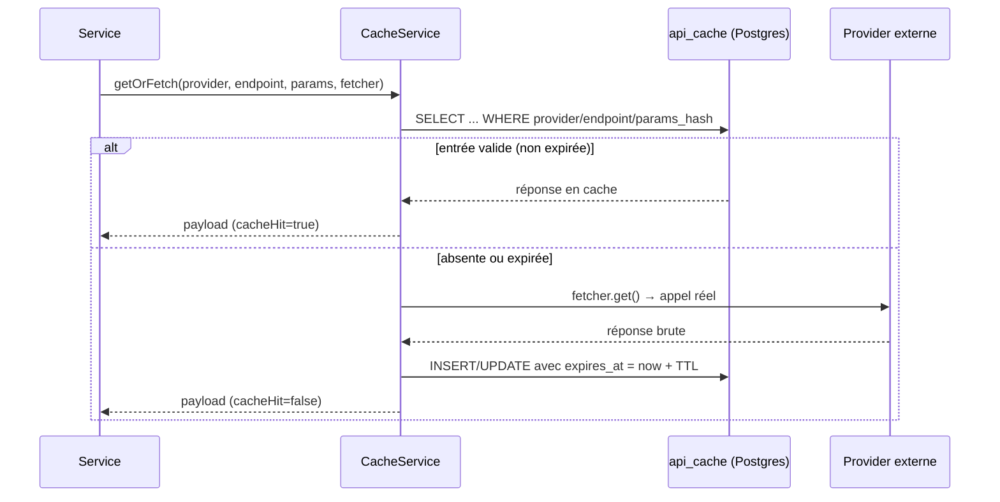
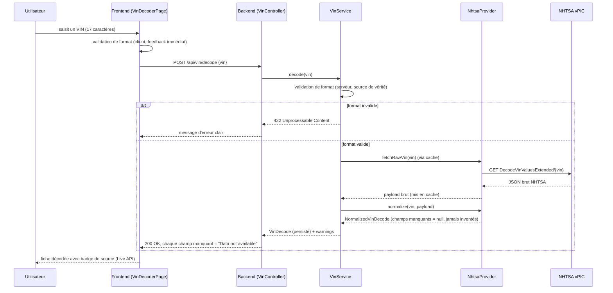

# Architecture — Vehicle Intelligence Platform

## 1. Vue d'ensemble

Application 100% locale composée de trois processus indépendants :

```text
http://localhost:5173   Frontend (React + Vite + TypeScript)
http://localhost:8000   Backend  (Spring Boot 4 / Java 17)
localhost:5432          PostgreSQL
```



## 2. Couches du backend

Le contrôleur **n'appelle jamais** directement une API externe ni le
`EntityManager`. Chaque couche a une responsabilité unique :

```text
Controller  → validation HTTP, mapping DTO ↔ entité, codes de statut
Service     → logique métier, orchestration, transactions
Adapter     → abstraction des sources de données externes (VehicleDataProvider,
              VinDecodeProvider) ; NhtsaProvider et DemoProvider implémentent
              ces interfaces
Repository  → accès base de données (Spring Data JPA)
```

### Abstraction des providers

```java
public interface VinDecodeProvider {
    String getName();
    boolean isConfigured();
    NormalizedVinDecode decode(String vin);
}

public interface VehicleDataProvider {
    String getName();
    boolean isConfigured();
    List<NormalizedVehicleSpec> search(...);
    List<String> listMakes();
    List<String> listModels(String make);
}
```

- `NhtsaProvider` implémente les deux interfaces avec de **vrais appels
  HTTP** vers `vpic.nhtsa.dot.gov` (décodage VIN, listes marque/modèle).
- `DemoProvider` implémente `VehicleDataProvider` à partir du fichier JSON
  local, pour les spécifications techniques complètes qu'aucune API gratuite
  ne fournit (voir `api-comparison.md`).

Ajouter une nouvelle source de données (ex: une API payante une fois une clé
obtenue) ne demande qu'une nouvelle classe implémentant l'interface adéquate
— aucune modification des contrôleurs ou services n'est nécessaire.

## 3. Flux de cache



Le cache stocke la **réponse brute du fournisseur**, jamais une donnée déjà
normalisée : la normalisation s'exécute à chaque lecture, cache ou non, ce
qui garantit qu'un changement de logique de normalisation s'applique aussi
aux entrées déjà en cache.

## 4. Séquence : décodage VIN



## 5. Frontend

```text
src/
  components/   composants réutilisables (ui, layout, search, vehicle, compare)
  pages/        une page par route
  layouts/      MainLayout (nav+footer), AuthLayout (login/register)
  contexts/     AuthContext (JWT + utilisateur courant), ToastContext
  services/     client Axios + un service par domaine (auth, vehicle, vin, comparison, history)
  hooks/        useAuth, useToast, useDebounce
  charts/       wrappers Recharts (Bar, Line, Radar) thémés
  types/        types TypeScript miroir des DTO backend
  utils/        formatters, validation VIN côté client
```

`AuthContext` conserve le JWT dans `localStorage`, l'injecte automatiquement
dans chaque requête Axios via un intercepteur, et purge le token sur toute
réponse 401.

## 6. Sécurité

- Mots de passe hashés avec BCrypt (`spring-security-crypto`), jamais en clair.
- JWT signé HMAC-SHA (bibliothèque JJWT), expiration configurable.
- `JwtAuthenticationFilter` peuple le contexte de sécurité si un token valide
  est présent, sans jamais rejeter la requête lui-même : c'est
  `SecurityFilterChain` qui décide, route par route, si l'authentification
  est obligatoire (ex: `/api/dashboard`) ou optionnelle (ex: `/api/vehicles`,
  où un utilisateur anonyme peut chercher, mais seul un utilisateur connecté
  voit sa recherche enregistrée dans l'historique).
- CORS restreint à `http://localhost:5173` par défaut (configurable).
- Aucune clé API n'est jamais exposée au frontend : toutes les variables
  sensibles restent côté backend (`application.yml` + variables d'environnement).

## 7. Exécution locale

Voir `docs/installation.md` pour le détail. En résumé :

```text
PostgreSQL (Docker ou installation locale) → :5432
./mvnw spring-boot:run (dans backend/)      → :8000
npm run dev (dans frontend/)                → :5173
```
