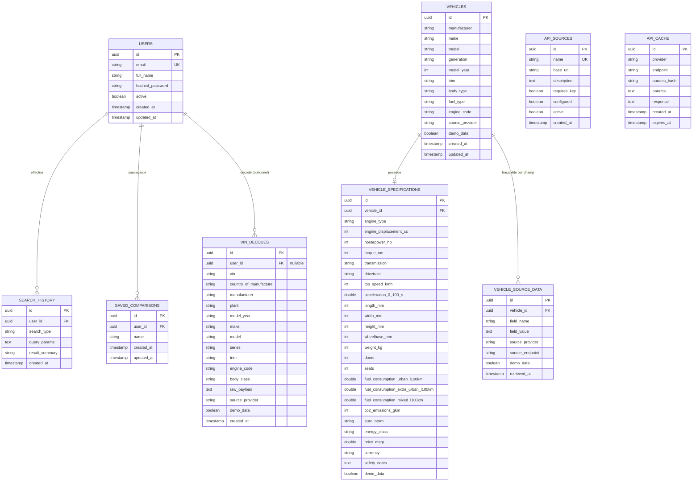

# Base de données — Vehicle Intelligence Platform

Moteur : **PostgreSQL 16**. ORM : **Spring Data JPA / Hibernate 7**, schéma
géré automatiquement en développement (`spring.jpa.hibernate.ddl-auto=update`).

## 1. Modèle entité-relation

`SAVED_COMPARISONS.vehicle_ids` est une collection d'éléments (`@ElementCollection`)
stockée dans une table associée `saved_comparison_vehicles(comparison_id, position, vehicle_id)`,
ce qui préserve l'ordre choisi par l'utilisateur.

## 2. Notes de conception

- **Clé primaire** : UUID généré côté application (`@UuidGenerator`), pas de
  séquence entière — évite toute fuite d'information sur le volume de
  données et facilite une éventuelle réplication.
- **`vehicles.model_year`** (et non `year`) : `year` est un mot réservé dans
  certains dialectes SQL (H2, utilisé pour les tests) et casse les requêtes
  non échappées ; le nom de colonne a été choisi pour rester portable.
- **Traçabilité (`vehicle_source_data`)** : chaque champ technique important
  (puissance, couple, consommation, CO₂, poids, prix) a sa propre ligne de
  provenance, avec le fournisseur, l'endpoint et la date de récupération —
  c'est ce qui alimente le bandeau "Source : NHTSA / Provider X" et le badge
  `Demo data` / `Live API` sur chaque valeur.
- **Cache (`api_cache`)** : indexé sur `(provider, endpoint, params_hash)`.
  `params_hash` est un SHA-256 des paramètres de requête canonicalisés
  (triés), ce qui permet une clé de cache stable indépendamment de l'ordre
  des paramètres.
- **Historique (`search_history`)** : `search_type` vaut `filter`, `vin` ou
  `vehicle_view` ; `query_params` est un JSON sérialisé permettant de
  reconstituer les filtres exacts utilisés (alimente le dashboard : nombre
  de recherches, répartition par carburant, activité dans le temps).
- **`is_demo_data` / `demo_data`** : présent sur `vehicles`,
  `vehicle_specifications`, `vehicle_source_data` et `vin_decodes` — jamais
  une donnée réelle n'est mélangée silencieusement avec une donnée de
  démonstration ; le frontend affiche systématiquement le badge correspondant.

## 3. Contraintes et index

| Table | Contrainte / Index |
|---|---|
| `users` | `UNIQUE(email)` |
| `vehicles` | index sur `manufacturer`, `make`, `model`, `model_year`, `fuel_type`, `external_id` |
| `vehicle_specifications` | `UNIQUE(vehicle_id)` (relation 1-1) |
| `api_cache` | index composite `(provider, endpoint, params_hash)` |
| `search_history` | index sur `(user_id, created_at)` implicite via la requête triée |
| Toutes les tables avec FK | `ON DELETE CASCADE` pour les entités "détail" (spécifications, sources, historique, comparaisons) rattachées à un parent supprimé ; `ON DELETE SET NULL` pour `vin_decodes.user_id` (un décodage VIN anonyme reste valide) |

## 4. Migrations

Le schéma est actuellement géré par Hibernate (`ddl-auto=update`), adapté à
un contexte académique où la base est recréée facilement. Pour une évolution
vers un contrôle de version de schéma explicite, `flyway-core` ou
`liquibase-core` s'intègrent nativement à Spring Boot sans changer le reste
de l'architecture (piste documentée dans `technical-decisions.md`).
